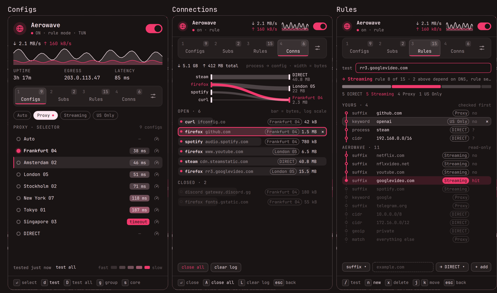
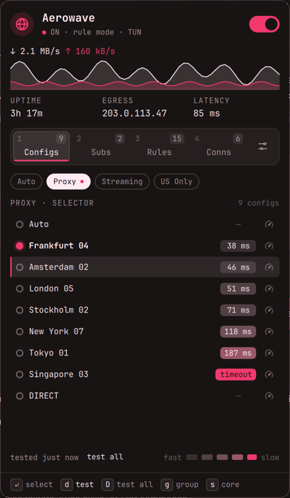
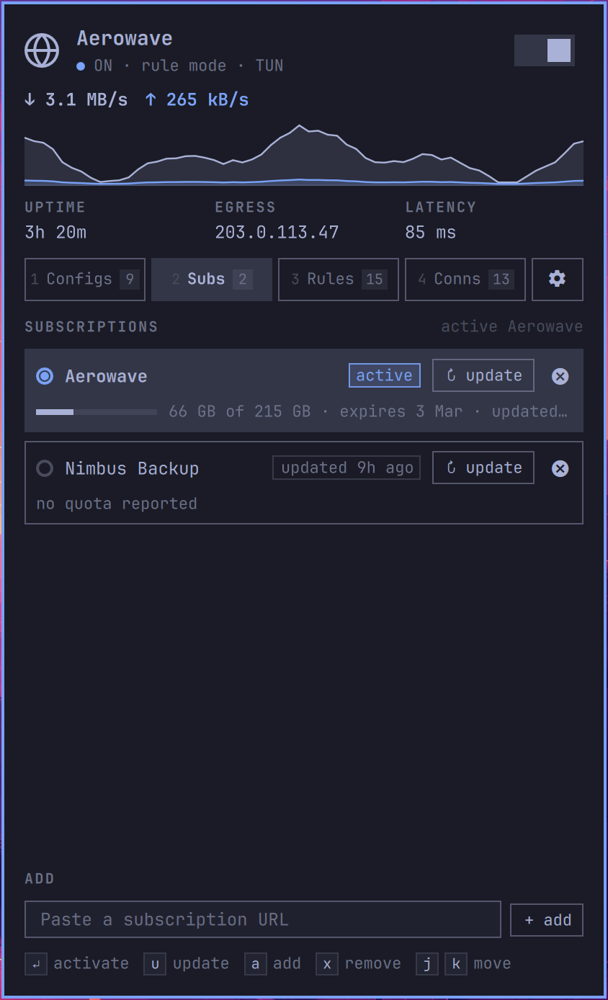
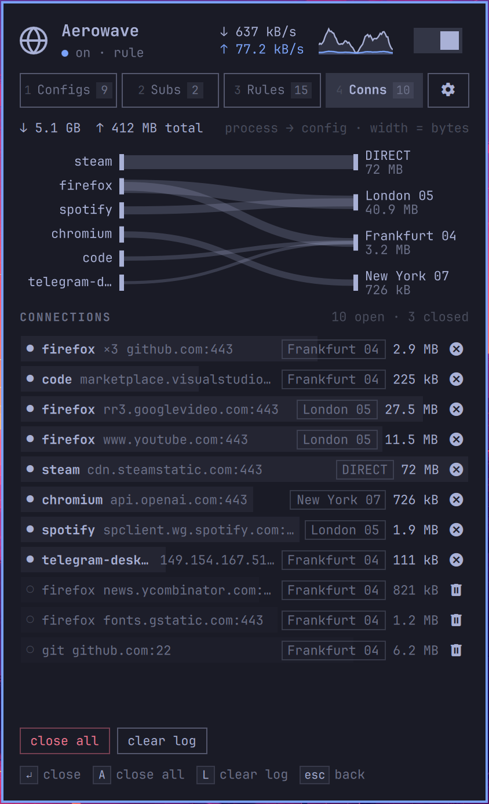
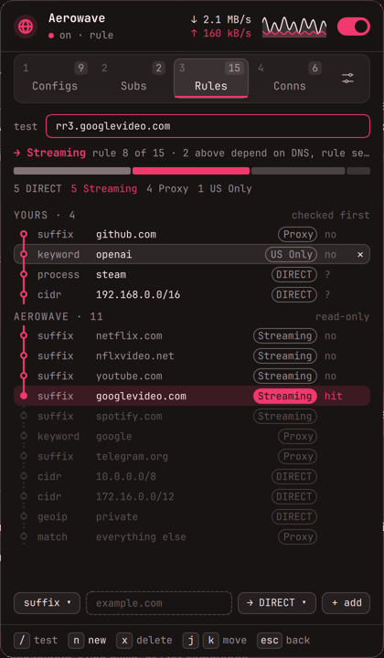
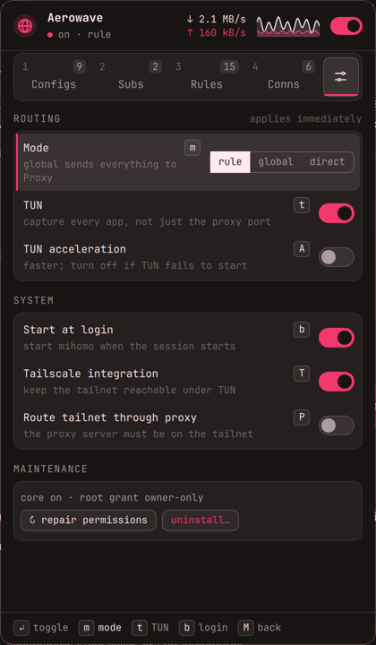

<div align="center">

<h1>
  
  Omihomo
</h1>

**The [mihomo](https://wiki.metacubex.one) proxy core, run from the Omarchy bar.**

Subscriptions, groups, latency, rules, TUN, and live connections, one keypress away.

[](https://omarchy.org)
[](manifest.json)
[](LICENSE)



</div>

## Features

- **One-click core.** Start, stop, and install the proxy from the bar. The icon dims when the core is off.
- **Subscriptions.** Paste a URL, and Omihomo imports it, names it, and refreshes it on the provider's schedule.
- **Groups and configs.** Pick a config, latency-test one or a whole group, and choose the primary group. Latency is colour-coded.
- **Live readout.** A traffic graph, uptime, and the egress IP with its round trip through the selected config.
- **Connections log.** Traffic drawn as process → config flows, and open and recently closed connections grouped by process and destination. Close one stack or all of them.
- **Your rules first.** Add `DOMAIN-SUFFIX`, `DOMAIN-KEYWORD`, `IP-CIDR`, and `PROCESS-NAME` rules that apply before the subscription's own rules, and test a domain or IP to see which rule catches it.
- **TUN, mode, Tailscale.** Toggle TUN, cycle rule, global, and direct mode, and route the tailnet through the proxy.
- **Keyboard first.** `1`–`4` switch views, `j`/`k` walk the view, and every action has a single-letter key.
- **Scriptable.** Everything the panel does is also an `omihomo` CLI verb.

## Screenshots

<table>
  <tr>
    <td align="center" width="33%"><br><sub>Traffic, groups, and latency</sub></td>
    <td align="center" width="33%"><br><sub>Subscriptions with quota and expiry</sub></td>
    <td align="center" width="33%"><br><sub>Flows and the connections log</sub></td>
  </tr>
  <tr>
    <td align="center"><br><sub>Rule tester and your rules</sub></td>
    <td align="center"><br><sub>Mode, TUN, autostart, and Tailscale</sub></td>
    <td></td>
  </tr>
</table>

## Requirements

- Omarchy 4 on Arch Linux
- `curl` and OpenSSL, for verified GitHub package installation
- A mihomo-compatible HTTPS subscription URL

## Install

```sh
omarchy plugin add https://github.com/readeem/omihomo.git --enable
omarchy bar move dev.readeem.omihomo
omarchy restart shell
```

Use the widget's **Install core** action to install the signed GitHub release and claim it
in a terminal. Settings checks for new releases and offers an **update** action, which updates
the widget through Omarchy and then the core package; installation and updates require normal
authentication and pacman confirmation. The daemon embeds mihomo, so updating the core updates
mihomo. AUR publication is an optional second channel.

## Usage

| Input | Action |
| --- | --- |
| Left click | Open the panel |
| Right click | Start or stop the core |
| Middle click | Refresh |
| `1` – `4`, `M` | Configs, Subs, Rules, Conns, settings |
| `j` / `k`, `enter` | Move, activate |
| `s` / `t` / `m` | Core on/off, TUN, mode |
| `a` / `n` | Add subscription, new rule |
| `d` / `D` | Latency test a config, a whole group |
| `/` | Filter configs, test a rule |

The full key map is in [docs/widget.md](docs/widget.md#keys), and every CLI verb is in
[docs/cli.md](docs/cli.md).

### Subscriptions

A subscription URL may return a full mihomo YAML config, or a raw share-link format that your
installed mihomo version understands. A raw subscription gets one generated `Proxy` selector and a
final `MATCH,Proxy` rule.

The daemon refreshes subscriptions on their provider's schedule (12 hours by default), including
while the panel is closed or the proxy is stopped. Failed refreshes preserve cached content.
See [daemon behavior](docs/daemon.md#subscriptions) for limits and retry rules.

## What it changes on your system

| Change | Location |
| --- | --- |
| Daemon binary and package-owned system units | `/usr/bin/omihomo`, `/usr/lib/systemd/system/omihomo.{service,socket}` |
| Editable settings and rules | `$XDG_CONFIG_HOME/omihomo/{settings,rules}.json` (defaults to `~/.config`) |
| User settings sync units | `/usr/lib/systemd/user/omihomo-apply.{path,service}` |
| Private subscriptions, cached settings, core cache and geodata | `/var/lib/omihomo`, root-owned `0700`, files `0600` |
| Recorded owner and socket ownership | `/var/lib/omihomo/owner`, `/etc/systemd/system/omihomo.socket.d/owner.conf` |
| Tailscale proxy drop-in, while its integration is enabled | `/etc/systemd/system/tailscaled.service.d/omihomo.conf` |
| Owner-only control socket | `/run/omihomo/omihomo.sock`, `0600` |

The daemon starts at boot and restores the proxy's last on/off state. TUN runs in the
[sandboxed root service](docs/adr/0006-sandboxed-root-service.md); no binary is setuid and no
upgrade hook grants privileges. Only the recorded owner controls it, through the kernel-verified
socket. The daemon allowlists subscription content and accepts typed settings only. The remaining
trust is the privileged daemon and its embedded dependencies, including process-inspection access.

Settings and rules can be tracked with a dotfile manager; see [settings files](docs/daemon.md#settings-files).
The widget has no separate settings. It shares the daemon's state with the CLI and receives
live traffic and connections while open. Omihomo never edits Hyprland or terminal settings.

## Remove

```sh
sudo pacman -R omihomo-bin
omarchy plugin remove dev.readeem.omihomo
```

Removing the package stops the daemon and keeps subscriptions and settings for reinstalling.
For permanent state removal, see
[removal](docs/daemon.md#removal).

## Development

[`mise`](https://mise.jdx.dev) pins the toolchain and runs the tasks; `mise tasks` lists them.

```sh
mise run check      # gofmt, go fix, go vet and the Go tests
mise run widget     # installer, widget model and Quickshell service tests
mise run security   # release signatures and isolated privileged package adapter
mise run package    # local Arch package and AUR metadata
```

The package build writes a local Arch package and AUR metadata under ignored `dist/`; it does
not install or publish anything. Follow [the manual test checklist](tests/README.md#manual-cutover-test)
to test the real daemon and widget. Never render or smoke-test the widget automatically.
Restart the installed shell with `omarchy restart shell` to try widget changes.

Architecture vocabulary is in [GLOSSARY.md](GLOSSARY.md), decisions in [docs/adr](docs/adr), and
maintainer setup in [the release guide](docs/release.md).

## License

GNU General Public License, version 3 only (`GPL-3.0-only`). See [LICENSE](LICENSE).

The daemon embeds mihomo, which is licensed under GPL-3.0.

Code contributed before the change to GPL-3.0-only was released under the MIT License. Its copyright
and permission notice is preserved below.

<details>
<summary>Original MIT license notice</summary>

```text
MIT License

Copyright (c) 2026 Readeem

Permission is hereby granted, free of charge, to any person obtaining a copy
of this software and associated documentation files (the "Software"), to deal
in the Software without restriction, including without limitation the rights
to use, copy, modify, merge, publish, distribute, sublicense, and/or sell
copies of the Software, and to permit persons to whom the Software is
furnished to do so, subject to the following conditions:

The above copyright notice and this permission notice shall be included in all
copies or substantial portions of the Software.

THE SOFTWARE IS PROVIDED "AS IS", WITHOUT WARRANTY OF ANY KIND, EXPRESS OR
IMPLIED, INCLUDING BUT NOT LIMITED TO THE WARRANTIES OF MERCHANTABILITY,
FITNESS FOR A PARTICULAR PURPOSE AND NONINFRINGEMENT. IN NO EVENT SHALL THE
AUTHORS OR COPYRIGHT HOLDERS BE LIABLE FOR ANY CLAIM, DAMAGES OR OTHER
LIABILITY, WHETHER IN AN ACTION OF CONTRACT, TORT OR OTHERWISE, ARISING FROM,
OUT OF OR IN CONNECTION WITH THE SOFTWARE OR THE USE OR OTHER DEALINGS IN THE
SOFTWARE.
```

</details>
